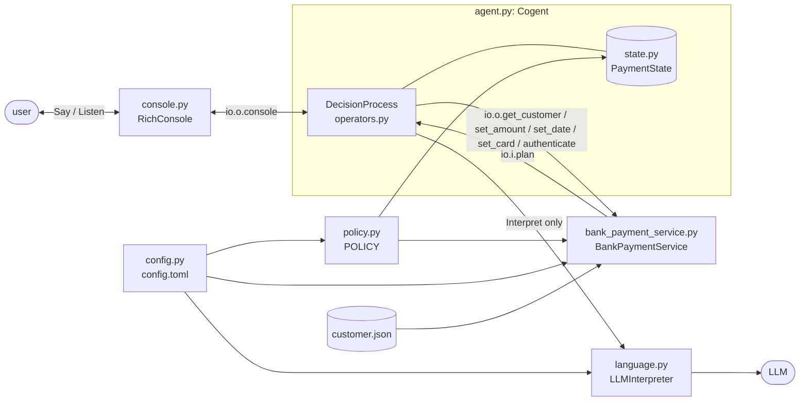

# Payment-plan assistant

[](LICENSE)

[](https://github.com/polycog/cognition)
[![cognition on PyPI](https://img.shields.io/pypi/v/polycog-cognition?label=cognition%20on%20PyPI&color=c47d20&labelColor=f3effa&logo=data:image/svg+xml;base64,PHN2ZyB4bWxucz0iaHR0cDovL3d3dy53My5vcmcvMjAwMC9zdmciIHZpZXdCb3g9IjIgMCAzNiAzNiIgZmlsbD0ibm9uZSI+PHBvbHlnb24gcG9pbnRzPSIyMCw0IDM0LjMsMTQuNCAyOC44LDMxLjYgMTEuMiwzMS42IDUuNywxNC40IiBzdHJva2U9IiM3YjJmYmUiIHN0cm9rZS13aWR0aD0iMi4yIi8+PGcgc3Ryb2tlPSIjYzQ3ZDIwIiBzdHJva2Utd2lkdGg9IjIiPjxsaW5lIHgxPSIyMCIgeTE9IjIwIiB4Mj0iMjAiIHkyPSI0Ii8+PGxpbmUgeDE9IjIwIiB5MT0iMjAiIHgyPSIzNC4zIiB5Mj0iMTQuNCIvPjxsaW5lIHgxPSIyMCIgeTE9IjIwIiB4Mj0iMjguOCIgeTI9IjMxLjYiLz48bGluZSB4MT0iMjAiIHkxPSIyMCIgeDI9IjExLjIiIHkyPSIzMS42Ii8+PGxpbmUgeDE9IjIwIiB5MT0iMjAiIHgyPSI1LjciIHkyPSIxNC40Ii8+PC9nPjxnIGZpbGw9IiM3YjJmYmUiPjxjaXJjbGUgY3g9IjIwIiBjeT0iNCIgcj0iMy4yIi8+PGNpcmNsZSBjeD0iMzQuMyIgY3k9IjE0LjQiIHI9IjMuMiIvPjxjaXJjbGUgY3g9IjI4LjgiIGN5PSIzMS42IiByPSIzLjIiLz48Y2lyY2xlIGN4PSIxMS4yIiBjeT0iMzEuNiIgcj0iMy4yIi8+PGNpcmNsZSBjeD0iNS43IiBjeT0iMTQuNCIgcj0iMy4yIi8+PC9nPjxjaXJjbGUgY3g9IjIwIiBjeT0iMjAiIHI9IjQuNiIgZmlsbD0iI2M0N2QyMCIvPjwvc3ZnPgo=)](https://pypi.org/project/polycog-cognition/)

**A neurosymbolic agent: the LLM interprets, and the symbolic system decides.**

A demo for [`polycog-cognition`](https://github.com/polycog/cognition): an interactive CLI that
shows a customer's payment plan and changes its amount, date or payment card, possibly several in
one utterance. It never changes the plan without an explicit yes.

- **Neural:** the LLM turns each utterance into structured terms: the tasks asked for, any amount,
  date or card stated, and a yes/no to a pending question.
- **Symbolic:** WHEN/THEN operators work through those tasks one at a time, check each detail
  against the payment policy, decide what each change needs, and ask for confirmation before
  changing anything.

A simulated **bank payment service** is in charge of the customer's records (`customer.json`):
nothing else reads or writes them. It offers its **APIs as tools** that the cogent calls while it
decides what to do, such as looking up the customer, changing the plan and authenticating the
user, and it re-checks the policy on its own. See [The bank payment service](#the-bank-payment-service).

## Contents

- [Quick start](#quick-start)
- [Configuration](#configuration)
- [How it works](#how-it-works)
- [The bank payment service](#the-bank-payment-service)
- [The decision process](#the-decision-process)
- [Layout and design docs](#layout-and-design-docs)
- [Development](#development)
- [License](#license)

## Quick start

**Requirements:** Python 3.13+, [uv](https://docs.astral.sh/uv/), and either a local
OpenAI-compatible server or an OpenAI API key.

```bash
uv sync
uv run python -m payments             # add --trace to see each decision-process choice
```

A session goes like this:

1. **Look up.** Before saying anything, the agent queries the bank payment service for the
   customer, which the service read from `customer.json`.
2. **Verify.** The assistant asks you to restate the customer's account number. Any format works
   (only the digits are compared), and the line is never sent to the LLM. After three wrong tries
   the session ends.
3. **Ask.** View the plan, or change the amount, date or card ("move it to the 20th and make it
   $75"). Each change is checked against the policy and put to you as a yes/no question.
4. **Confirm.** Say yes, and the bank payment service makes the change and saves it to
   `customer.json`. Switching to a debit card whose limit is over $5,000 also asks for a
   simulated key phrase (`neurosymbolic`, once per session).
5. **Leave** with `quit`, `exit`, `bye`, `done` or Ctrl-D.

With `--trace`, each decision cycle prints the operator chosen, in pink if it calls the LLM
(`interpret`) and blue otherwise, followed by the other operators that applied.

## Configuration

All settings are in [`config.toml`](config.toml).

**Language model.** Choose a profile by setting `use` under `[llm]`:

| Profile | Model | Needs |
|---|---|---|
| `local` (default) | `openai/gpt-oss-20b` | An OpenAI-compatible server at `http://localhost:1234/v1` (such as LM Studio) |
| `openai` | `gpt-4o` | `OPENAI_API_KEY` |

**Policy.** `[policy]` sets the largest allowed amount, how many days out a payment may be
scheduled, how many tries the user gets to restate their account number, and the debit-card
limit above which switching to that card needs extra authentication.

**Customer.** `customer_file` names the JSON file describing the account holder (default
[`customer.json`](customer.json)):

- name and account number;
- cards on file, each with an `id`, its `kind` (`credit` or `debit`), network, last four digits
  and payment limit;
- the payment `plan`: its amount, the `card_id` it is paid with, and when it is sent, as
  `payment_in_days` (days from today, so the demo never goes stale) or a fixed `payment_date`.
  Its account number is the customer's.

The bank payment service reads this file at startup and writes confirmed changes back to it, so
they're still there next time. A changed date is saved as a fixed `payment_date`; amount and card
changes keep a relative `payment_in_days`. To start over, restore the file (e.g.
`git checkout customer.json`).

## How it works



Imports only point one way, so each layer can be read and tested on its own:
`config ← policy ← bank_payment_service ← language ← state ← operators ← agent ← __main__` (and
`console ← operators`).

**One user turn** is one cogent loop. The same `PaymentState` survives across turns; only the
user's yes/no is reset.

1. **Input:** at the very start, the agent queries the bank payment service for the customer.
   Before verification, the user's line is compared, by code, with the account
   number. After it, `interpret` sends the line to the LLM and merges the result into the agenda.
2. **Settle:** if the user answered a standing proposal, authenticate (if an operator asked for
   it), then confirm or decline.
3. **Assess:** before a change is proposed, rules decide what it needs (e.g. a switch to a
   high-limit debit card needs extra authentication).
4. **Act:** show the plan, ask for a missing detail, reject a detail that breaks policy, propose a
   change, re-ask, or wrap up.
5. An operator that ends the turn says everything queued and reads the user's next line.

**Design principles**

- **The LLM proposes, the user decides.** LLM output only fills the agenda and details; changes
  happen in confirm operators after an explicit yes.
- **What the LLM never sees:** the account number (verified before anything is interpreted) and
  full card numbers (only the last four digits are stored at all).
- **Policy as data.** Rules live in `POLICY` and `PolicySettings`; the agent and the bank
  payment service call the same `violation()` check, and the service enforces it on its own.
- **The agent asks the bank; it isn't handed the data.** The customer arrives through an API
  query at session start, and every change goes through the service's API.
- **One operator shape:** WHEN/THEN docstring, positive guards, `can_perform` binds the values
  `perform` uses, one decision per operator.
- **Priority levels only where operators can overlap;** within a level they are mutually
  exclusive.
- **Everything external is injected** (clock, LLM, console, authentication prompt), so the tests
  run offline and deterministically.

## The bank payment service

> [!IMPORTANT]
> **The simulated bank payment service owns `customer.json`, and its APIs are the cogent's tools.**
> The agent never opens the file or edits the plan itself. When an operator needs the bank (to
> look up the customer, read the plan, change it, or authenticate the user) it calls one of the
> service's APIs, wired into the cogent as a sensor or an actuator, as part of its decision
> making.

`payments/bank_payment_service.py` stands in for the bank's system of record:

- **In charge of `customer.json`.** It reads the file at startup (`BankPaymentService.from_file()`),
  keeps the customer and plan of record, and writes every confirmed change back.
- **APIs as tools.** `build_agent` wires each API into the cogent: `get_customer`, `set_amount`,
  `set_date`, `set_card` and `authenticate` as actuators (`io.o.<name>(...)`), and the plan as a
  sensor (`io.i.plan`, read at the start of every turn). Operators call the actuators from
  `perform`, so every tool call happens inside a named operator, one you can follow with `--trace`.
- **Independent.** It re-checks the policy on every change, whatever the agent decided.

| API | Tool in the cogent (who calls it) | Does |
|---|---|---|
| `get_customer()` | actuator `get_customer`, called once by `fetch_customer` | returns the customer: name, account number, cards on file |
| `plan` | sensor `plan`, read every turn | the plan of record |
| `set_amount` / `set_date` / `set_card` | actuators, called by the confirm operators | re-checks the policy, changes the plan, saves `customer.json` (raises `PolicyViolation` if refused) |
| `require_authentication(purpose)` | actuator `authenticate`, called by `authenticate` | simulated key-phrase check, once per session (raises `AuthenticationFailed`) |

The CLI creates it with `BankPaymentService.from_file()`. Tests build it from in-memory data
instead, so they never touch the real file. See
[design_docs/bank_payment_service.md](design_docs/bank_payment_service.md).

## The decision process

There is no scripted flow. Each cycle, every operator whose WHEN holds is proposed, and the one
with the lowest priority runs. One user turn ends when an operator that speaks to the user runs.

`PaymentState` persists across turns: an **agenda** of tasks still to do, **details** the user has
already given, a **proposal** awaiting yes/no, and flags such as `needs_authentication`.

| Priority | Operator | WHEN |
|---|---|---|
| 1 `INPUT` | `fetch_customer` | the session has just started → query the bank payment service for the customer |
| 1 `INPUT` | `greet` / `say_goodbye` | the customer has been fetched (asks for the account number) / the user left |
| 1 `INPUT` | `accept_account_number` | the unverified user restated the customer's account number |
| 1 `INPUT` | `reject_account_number` | the unverified user said something else, with tries left → ask again |
| 1 `INPUT` | `end_unverified_session` | …on their last try → end the session |
| 1 `INPUT` | `interpret` | the verified user said something not yet interpreted (LLM) |
| 1 `INPUT` | `ask_to_rephrase` | the LLM could not interpret it |
| 2 `SETTLE` | `authenticate` | a proposal that still stands got yes, and an operator set `needs_authentication` |
| 2 `SETTLE` | `confirm_amount_change` / `confirm_date_change` / `confirm_card_change` | a proposed change that still stands got yes, and needs no (more) authentication |
| 2 `SETTLE` | `decline_change` | a proposal that still stands got no |
| 3 `ASSESS` | `require_authentication_for_high_limit_debit` | the change in focus switches to a debit card with a limit over the threshold, not yet proposed → set `needs_authentication` |
| 4 `ACT` | `show_plan` | the user asked to see the plan (views jump the queue; read-only) |
| 4 `ACT` | `request_value` | the change in focus has no detail yet → ask |
| 4 `ACT` | `reject_value` | the detail breaks policy → explain, ask again |
| 4 `ACT` | `propose_change` | a valid detail not yet proposed → ask to confirm |
| 4 `ACT` | `await_confirmation` | proposed, but no yes/no → ask again |
| 4 `ACT` | `wrap_up` | the agenda is empty → "anything else?" / help |

Within a level, operators never apply together; the levels only matter because work left over
from the last turn is still in the state when new input arrives. Stating a detail implies its
change; revising a detail voids the old proposal. See
[design_docs/operators.md](design_docs/operators.md) for how operators are written.

## Layout and design docs

| File | What it holds | Design doc |
|---|---|---|
| `config.toml` | every setting: LLM profile, policy limits, customer file | [config](design_docs/config.md) |
| `customer.json` | the demo customer, cards and plan | [bank_payment_service](design_docs/bank_payment_service.md) |
| `payments/config.py` | reads `config.toml`; each module reads its own table | [config](design_docs/config.md) |
| `payments/policy.py` | the policy as data: `POLICY` maps each plan term to `(must_be, limit, message)` rules | [policy](design_docs/policy.md) |
| `payments/bank_payment_service.py` | the simulated bank payment service: reads and saves `customer.json`, answers the agent's queries (customer, plan), re-checks the policy, extra authentication | [bank_payment_service](design_docs/bank_payment_service.md) |
| `payments/language.py` | the only LLM use: utterance → `Interpretation` | [language](design_docs/language.md) |
| `payments/state.py` | decision-process state: agenda, details, pending proposal, flags | [state](design_docs/state.md) |
| `payments/operators.py` | the WHEN/THEN operators and their `Priority` levels | [operators](design_docs/operators.md) |
| `payments/console.py` | console I/O as a cognition actuator, and operator tracing | [console](design_docs/console.md) |
| `payments/agent.py` | wiring sensors, actuators and operators into a `Cogent` | [agent](design_docs/agent.md) |
| `payments/__main__.py` | CLI | [main](design_docs/main.md) |
| `tests/test_agent.py` | offline tests with a scripted user and a fake LLM | [tests](design_docs/tests.md) |

Each design doc in [`design_docs/`](design_docs) explains what its file does, why it is built that
way, and how to extend it.

## Development

```bash
uv sync
uv run --group dev pytest             # offline: uses a fake LLM and a scripted console, no API key needed
uv run --with mypy mypy payments      # type check
```

## License

Released under the [Apache License 2.0](LICENSE). Copyright (c) 2026 Polycog Inc.
