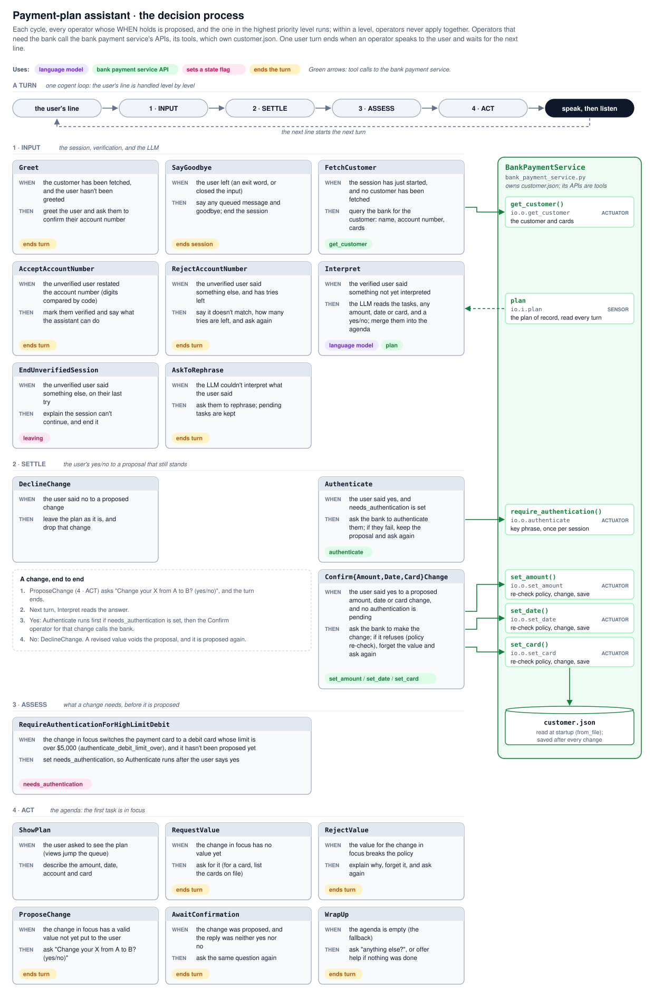

# Technical Approach

This demo is a conversational agent built with [`cognition`](https://github.com/polycog/cognition), a library for building neurosymbolic agents. It addresses the problem described in the [use case](usecase.md): giving a banking customer a frictionless experience while complying fully with the bank's policies.

## Approach

The agent splits the work between two kinds of reasoning, so that each does what it does best:

- **Neural reasoning understands language.** An LLM turns what the customer types into structured terms: what they want done, any amount, date or card they mention, and whether they said yes or no. These terms are only proposals. The LLM never changes the plan, never decides what happens next, and never sees the account number.
- **Symbolic reasoning decides and acts.** WHEN/THEN operators, ranked by priority, decide everything else: they verify the customer, check each change against the payment policy, work out what the change needs, and ask for a yes before making it. No LLM takes part in these steps, so the same state always leads to the same action, and every step can be traced.

A simulated **bank payment service** holds the customer's records (`customer.json`), and nothing else reads or writes them. It offers its **APIs as tools** that the agent calls as it decides what to do: looking up the customer, changing the plan, and authenticating the user.

## Example

Sam Lee, already verified, pays $200 a month with a Mastercard debit card, and types:

> *"Pay with my Visa debit instead."*

1. **Neural.** The LLM reads the sentence against the cards on file and proposes two terms: the intent is *change card*, and the card is `card3`, the Visa debit card ending 1881. It does not judge whether the change is allowed.
2. **Symbolic.** The operators take over:
   - `RequireAuthenticationForHighLimitDebit` sees that `card3` is a debit card with a $10,000 limit, above the $5,000 threshold in the policy, so the change needs extra authentication.
   - `ProposeChange` asks: *"Change your payment card from your Mastercard debit card ending 5454 to your Visa debit card ending 1881? (yes/no)"*
3. **Neural.** Sam answers *"yes"*, and the LLM reads it as a yes.
4. **Symbolic.** `Authenticate` asks the bank payment service to check Sam's key phrase. Only if it passes does `ConfirmCardChange` call the service to switch the card; then `WrapUp` asks whether there is anything else.

Had Sam asked for a debit card with a lower limit, no authentication would be needed: strong authentication applies only where the policy calls for it. Had Sam asked to pay $20,000, the policy would reject the amount, whatever the LLM proposed.

## Decision process

The figure shows every operator, the priority level it runs at, and the calls it makes to the bank payment service.

## Details

The design is documented in [`design/`](design), one doc per file: what each part does, why it is built that way, and how to extend it. Start with the operators.

- [Operators](design/operators.md): the decision process
- [State](design/state.md): what the agent remembers about the conversation
- [Bank payment service](design/bank_payment_service.md): the customer's records and the APIs over them
- [Language](design/language.md): the one place the LLM is used
- [Policy](design/policy.md): payment limits and when authentication is needed
- [Console](design/console.md): all interaction with the user, and the `--trace` view
- [Agent](design/agent.md): how state, operators and tools are assembled into an agent
- [Config](design/config.md): the settings in `config.toml`
- [Main](design/main.md): the command-line entry point
- [Tests](design/tests.md): the offline test suite
